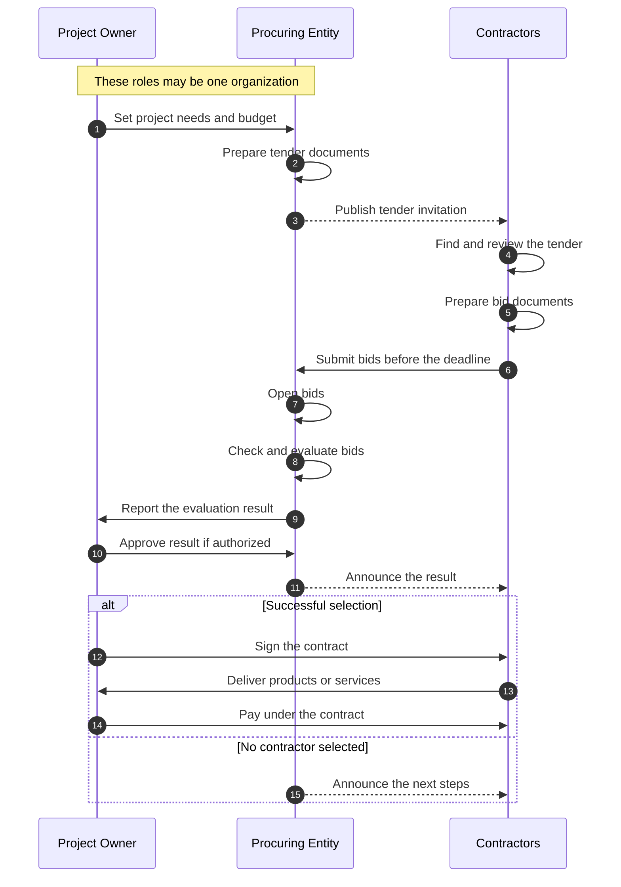
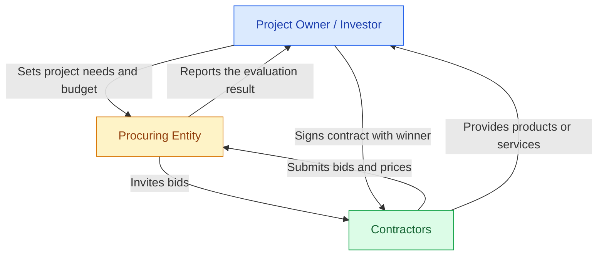
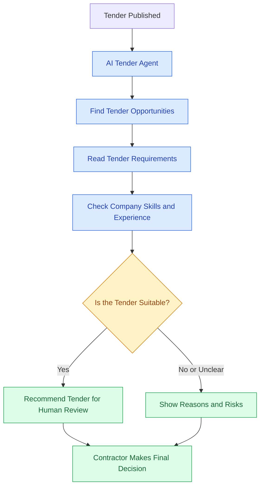
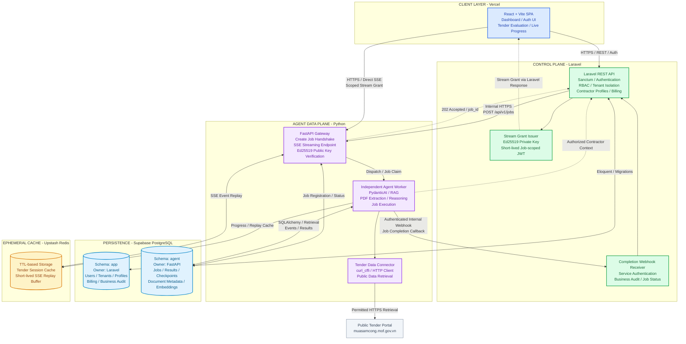

# MSC Tender Hunter Agent

<strong>MSC Tender Hunter Agency – A Graduation Internship Project on Tender Automation </strong>

  
  
  
  
  
  
  
  
  
  
  

## I. Foundational Concept

A tender/bid package is a part of a project or a purchasing plan. It can include consulting services, service integration, software development, or other types of work. Bid packages can play an important role in the growth of small and large businesses, both in Vietnam and around the world.

> [!NOTE]
> 
> In simple terms, the bidding process involves three main roles: the project owner or investor, the organization that invites bids, and the contractor who provides the required products or services. Sometimes, the project owner and the organization inviting bids can be the same company.

> [!IMPORTANT]
> 
> This process can benefit both sides. The project owner wants to find a qualified contractor who can meet the project’s needs, such as consulting and service integration. At the same time, contractors look for bid packages that match their skills, have risks they can manage, and offer good opportunities to make money.

As AI technology develops quickly, AI agents and automated systems are becoming more useful in the bidding process. These tools can help companies identify suitable bid packages, review project requirements, assess potential risks, and prepare stronger bids. They can also help project owners find suitable contractors.

## II. Project Aim and Scope

The main goal of this project is to develop an AI Agent system that helps contractors in Vietnam find tender opportunities and check how suitable they are for their businesses. The system will help contractors find useful information, understand project requirements, and make better decisions before joining a tender. The project will focus on building a working Minimum Viable Product (MVP) within the planned time.

### Specific objectives include:

1. Develop a basic SaaS platform with main features similar to those on dauthau.asia and the MSC. The platform will allow users to search for tenders, filter results, view tender details, and use AI Agent services. Time: November 2, 2026, to November 15, 2026.

2. Research and develop an AI Agent that can search for tender opportunities and work without the SaaS backend.
The Agent must be able to work with other systems in the future. It will support MCP (Model Context Protocol) and A2A (Agent-to-Agent) through basic interfaces.
This stage will focus on research, building the first working version, and testing the main features.
Time: November 2, 2026, to November 8, 2026.

3. Complete the AI Agent and test it with a selected group of tender examples.
The tests will check whether the Agent can find useful tenders, read their requirements, and explain how well they match a contractor’s business.
After testing, the Agent will be connected to the SaaS platform.
Time: November 16, 2026, to November 22, 2026.

4. Deploy the MVP to a production environment for a limited pilot test.
Monitor the system, fix problems, and improve its performance.
The system must protect user data, control access, process requests within a reasonable time, and support several users at the same time.
Time: November 23, 2026, to December 6, 2026.

### The scope is defined as follows:
1. The AI Agent will only support contractors who want to find and review tender opportunities.
The system will not support project owners, investors, or organizations that invite contractors to bid at this stage.

2. The system will only search for tender opportunities in Vietnam.
The main target source is the MSC: muasamcong.mof.gov.vn
International tenders and other tender platforms are not included in this project.

3. The system must protect private company information.
It must include secure user login, strict access control, and safe handling of business data.
Private company information should not be sent to third-party services unless it is needed, allowed, and properly protected.
The system must also follow the relevant data protection laws in Vietnam.

4. Tender data will be collected through permitted APIs or web search methods.
The system will not create a permanent database of copied tender documents during the MVP stage.
Tender data will only be stored for a short time in a temporary cache during an active user session.
This design helps reduce data storage, security, and legal risks.

5. Due to the short development period, the project will focus on its main functions.
The MVP will not include automatic bid submission, full tender document writing, online payment, or advanced multi-agent workflows.
AI results will help users make decisions, but they will not replace human review.

## III. Project Tech-stacks

The proposed stack is documented in [ADR-001](docs/adrs/ADR-001-technology-stack.md). The overall ADR remains **Proposed / In review**. PydanticAI has been selected as the primary agent framework; the remaining architecture is still under review. These technologies describe the planned stack, not an implemented system.

| Layer | Proposed technology | Purpose |
| --- | --- | --- |
| Frontend | React + Inertia + Vite | Build interactive pages connected to Laravel routes and controllers; use Vite to build frontend assets. |
| Backend | Laravel | Handle the web application, authentication, authorization, and business logic. |
| Database | PostgreSQL hosted on Supabase | Store application data; use Supabase as the database host. |
| Agent service | Python + FastAPI | Expose the independent Python agent system through an API. |
| Agent core | PydanticAI | Primary framework for typed agent tools and structured extraction/matching outputs. |

PydanticAI is selected as the primary agent framework. LangGraph, LlamaIndex, Haystack, and CrewAI are retained as considered alternatives in ADR-001. The badge records the latest stable PyPI release checked on November 3, 2026: [2.65.0](https://pypi.org/project/pydantic-ai/2.65.0/). This is a documentation reference, not an installed or locked dependency version.

The React, Vite, Laravel, FastAPI, and PostgreSQL badges also show upstream stable releases checked on November 3, 2026. They are reference versions, not installed or locked dependencies. The PostgreSQL version available for this project's Supabase instance has not been chosen or verified.

Authentication/SSO implementation, queues, temporary cache, document handling/storage, model provider, observability, and application/agent hosting remain TBD while the SRS and BDRS are developed. Supabase Auth, Storage, and other Supabase services are not selected by choosing its PostgreSQL hosting. Database use must respect the MVP scope above: tender data is temporary, and copied tender documents are not stored permanently.

## IV. Overall Structure of the Project 

## V. Project License and Legal Issue

> [!NOTE]
>
> The project is licensed under the Mozilla Public License Version 2.0, with legal terms based on Vietnamese law regarding public procurement, the use of artificial intelligence, and data mining for academic purposes. For further details, please see [License and Legal Issues](docs/legal-issues/)

## VI. Contributors

Currently, I am the primary contributor (the developer). There are also some indirect contributors, such as Nhu and Huy (colleagues from my workplace). Other contributions will be listed below:
1. [Holder 1 - Contribution in 1]()
2. [Holder 2 - Contribution in 2]()
3. [Holder 3 - Contribution in 3]()

## VII. Documents and References

1. References: [Docs](docs/references/)
2. Project and Package License: [License](docs/license/)
3. Legal issues in the project: [Legal-Issues](docs/legal-issues/)
4. Developer Daily Report: [Daily-Report](docs/report/)
5. Software Requirements Specification: [SRS](docs/srs/)
6. Business Requirements Document: [BDRS](docs/bdrs/)
7. Architecture Decision Record: [ADRS](docs/adrs/)
8. SaaS Live Production: Not Available  

## VIII. Acknowledge of using AI

Although this project uses AI, mainly for high-level planning, I decided to use the **Mozilla Public License Version 2.0 (MPL 2.0)** for the following reasons:

1. To carefully control the use of AI-generated code and third-party packages in my internship graduation project.
2. This project was not started because of my personal interests. Instead, it was requested by an external partner (my internship supervisor).
3. Choosing the MPL 2.0 helps me learn more about copyright, software licenses, and open-source responsibilities for future projects.

However, if you find any source code in this project that is very similar to code you have developed, please feel free to contact me. We can discuss giving proper credit, adding your contribution, or removing the related code if necessary.

Thank you for your understanding!

---

(c) 2026 Van Trung Thanh
