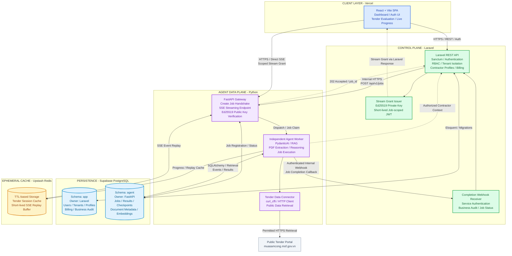
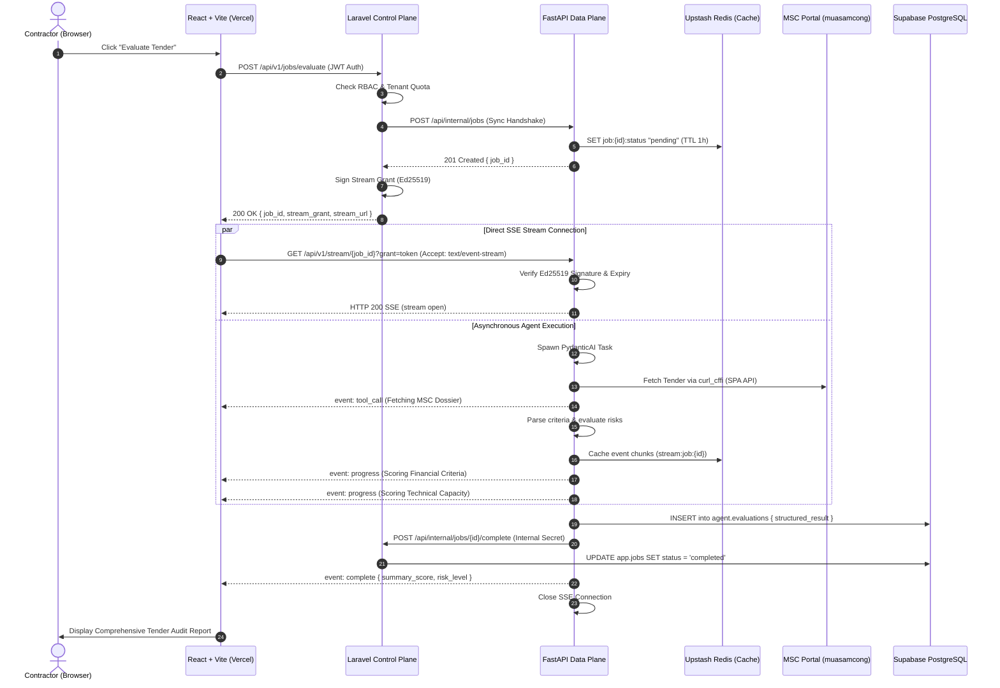

# ADR-002: Split-Gateway Direct-Streaming System Architecture

- Status: Accepted
- Date: 2026-11-03
- Deciders: TenderHunter Development Team
- Technical Scope: System topology, inter-service protocols, stream authorization, event lifecycle, and failure recovery

---

## 1. Context and Problem Statement

[`ADR-001: Proposed Project Technology Stack`](file:///c:/Users/hp/Desktop/MyProjects/MSC-Tender-Hunter-Agent/docs/adrs/ADR-001-technology-stack.md) selected **React + Vite (Vercel)**, **Laravel (PHP)**, **FastAPI + PydanticAI (Python)**, **Supabase PostgreSQL**, and **Upstash Redis**. 

Procurement tender evaluation on Vietnam's National Bidding Network System (MSC: `muasamcong.mof.gov.vn`) involves multi-step scraping, document parsing (PDF/Excel), and LLM reasoning that can take 30 to 90 seconds per dossier. In a standard monolithic or single-gateway proxy architecture:
1. **PHP-FPM Worker Starvation**: Long-lived HTTP streaming connections through Laravel hold worker processes hostage, quickly exhausting concurrency pools.
2. **Gateway Buffering & Timeouts**: Reverse proxies and serverless gateways often enforce 30-second execution timeouts or buffer chunked responses, breaking real-time token streaming.
3. **Resource Constraints**: Production relies on free-tier Redis (Upstash), requiring that Redis be treated strictly as an **ephemeral cache**, avoiding heavyweight message broker or persistent queue overhead.

A concrete system architecture is required to decouple user access control from high-throughput agent streaming while maintaining zero data leaks, low memory overhead, and future compatibility with native mobile apps.

---

## 2. Decision: Split-Gateway Direct-Streaming Architecture

We adopt the **Split-Gateway / Direct-Streaming (Client-Server) Architecture**, segregating responsibilities into a **Control Plane** (Laravel) and an **Agent Data Plane** (FastAPI) communicating with a decoupled **Client** (React + Vite on Vercel).



---

## 3. Detailed Architectural Specifications

### 3.1. Dual-Channel Control & Streaming Protocols

1. **Control Channel (HTTPS REST)**:
   - Client connects exclusively to Laravel for tenant onboarding, authentication, contractor capability profiles, tender search queries, and job creation.
   - All standard business logic and permission gates reside strictly in Laravel.

2. **Streaming Channel (Server-Sent Events - SSE)**:
   - Client establishes a direct, persistent HTTP connection to FastAPI's SSE endpoint (`GET /api/v1/stream/{job_id}`) using the browser's native `EventSource` or `fetch` with `ReadableStream`.
   - Bypasses Laravel entirely for token streaming, tool call updates, and step-by-step reasoning progress.

---

### 3.2. Cryptographic Stream Grant Contract

To ensure FastAPI never exposes public unauthenticated streaming endpoints or reads directly from Laravel's user database, access is authorized using **Cryptographic Stream Grants**:

- **Primary Mechanism (Asymmetric Ed25519 / RS256)**:
  - Laravel holds an asymmetric private key and signs a compact Stream Grant JWT when a job is created.
  - FastAPI maintains Laravel's public key (or fetches it from a local JWKS) and validates incoming requests without network overhead.
- **Grant Claims Payload**:
  ```json
  {
    "sub": "usr_9b1deb4d",
    "tenant_id": "ten_01h7x",
    "job_id": "job_01jbc28",
    "allowed_events": ["progress", "thought", "result", "error"],
    "exp": 1793703600,
    "iat": 1793703000
  }
  ```
- **Alternative Consideration**: Symmetric HMAC-SHA256 using a shared secret (`STREAM_GRANT_SECRET`) is maintained as a fallback option for local development or simplified initial deployment if asymmetric key distribution introduces operational friction.

---

### 3.3. Job Handshake & Execution Lifecycle (Cache-Only Redis)

Because Redis is hosted on free-tier Upstash, it is reserved strictly for **ephemeral caching**, not as a persistent queue broker (e.g., Celery or Redis List queue).

#### Synchronous Handshake Flow:
1. **Client $\rightarrow$ Laravel**: User initiates an evaluation request:
   `POST /api/v1/tenders/{tender_id}/evaluate` with contractor parameters.
2. **Laravel $\rightarrow$ FastAPI**: Laravel performs an internal synchronous HTTP handshake:
   `POST http://fastapi:8000/api/internal/jobs` passing the validated tenant contractor constraints and target tender identifier.
3. **FastAPI Initialization**: FastAPI initializes the job context, registers a transient tracking key in Redis (`job:{job_id}:status = "pending"` with 1-hour TTL), and returns `{ "job_id": "job_01jbc28" }` to Laravel within $<100$ ms.
4. **Laravel $\rightarrow$ Client**: Laravel signs the Stream Grant and returns:
   ```json
   {
     "job_id": "job_01jbc28",
     "stream_grant": "eyJhbGciOiJFZERTQ...",
     "stream_url": "https://agent.tenderhunter.vn/api/v1/stream/job_01jbc28"
   }
   ```
5. **Background Agent Trigger**: FastAPI spawns an asynchronous background task (`asyncio.create_task`) running the PydanticAI evaluation pipeline.

---

### 3.4. Resilient SSE Reconnection & Ephemeral Replay Buffer

To withstand client network drops, Wi-Fi switching, or browser refreshes during multi-step tender evaluations:

1. **Ephemeral Event Chunks in Redis**:
   - As FastAPI generates SSE events (`event: progress`, `event: thought`, `event: tool_call`), it writes them to a short-lived Redis Stream or List: `stream:job:{job_id}`.
   - An aggressive TTL (1 hour) is set on the key to prevent memory bloat on Upstash Redis.
2. **Reconnection via `Last-Event-ID`**:
   - Each SSE event contains an incrementing ID (e.g., `id: 12`).
   - If disconnected, the React client reconnects passing the standard HTTP header:
     `Last-Event-ID: 12`.
   - FastAPI replays events from index $13$ onwards from the Redis cache before resuming real-time streaming.
3. **Terminal Event**:
   - Once evaluation finishes, FastAPI sends a terminal `event: complete` with the final payload and closes the SSE channel.

---

### 3.5. Job Completion Callback & State Synchronization

1. **Direct Webhook Callback**:
   - Upon completing the PydanticAI execution, FastAPI sends an authenticated internal HTTP request:
     `POST http://laravel:8000/api/internal/jobs/{job_id}/complete`
   - Payload includes high-level summary scores, status (`completed` / `failed`), and execution metadata.
2. **Database Schema Segregation (Supabase PostgreSQL)**:
   - **Laravel**: Updates the job status and notification indicators in the `app` schema.
   - **FastAPI**: Persists the full evaluation audit trail, LLM token metrics, and extracted criteria into the `agent` schema.
   - Neither service directly modifies tables belonging to the other.

---

## 4. End-to-End Sequence Diagram



---

## 5. Protocol Boundaries: FastMCP & A2A Integration

The architecture preserves complete autonomy for the Python Agent Core:

```
                         +-----------------------------+
                         |      Agent Core Logic       |
                         | (PydanticAI + curl_cffi)    |
                         +--------------+--------------+
                                        |
         +------------------------------+------------------------------+
         |                              |                              |
         v                              v                              v
+------------------+          +------------------+          +------------------+
| FastAPI Adapter  |          | FastMCP Adapter  |          |   A2A Adapter    |
| - REST Endpoints |          | - STDIO (Local)  |          | - Agent Cards    |
| - SSE Streamer   |          | - Streamable HTTP|          | - Authenticated  |
| - Stream Grants  |          | - Bearer Auth    |          |   P2P Protocol   |
+------------------+          +------------------+          +------------------+
         |                              |                              |
      (SaaS)                      (IDE / Cursor)               (External Agents)
```

1. **FastMCP**:
   - Implemented via the official Python MCP SDK with `FastMCP`.
   - Exposes tools (`search_msc`, `evaluate_suitability`, `audit_risks`) over **STDIO** for local usage (Cursor, Claude Code, CLI) and **Streamable HTTP** (`/mcp`) for remote platform consumers.
2. **A2A (Agent-to-Agent)**:
   - Modular interface adapter exposing authenticated Agent Cards for interoperability with external enterprise agents.
3. Both FastMCP and A2A exist as thin external adapters wrapping the same PydanticAI Agent Core without cross-polluting SaaS-specific HTTP logic.

---

## 6. Forward-Looking Considerations

### 6.1. MSC Scraping Concurrency and Anti-Bot Policy
- **Status**: Deferred to detailed design before pilot deployment.
- **Design Directive**: Scraping against `muasamcong.mof.gov.vn` must implement a global rate-limiting policy (e.g., token bucket with jitter in Redis) to prevent IP bans. Proxies or TLS-fingerprint rotation via `curl_cffi` will be configured in the agent extraction pipeline.

### 6.2. Key Distribution & Rotation
- Ed25519 public keys will be mounted via environment variables in the FastAPI container. If key rotation is required, Laravel will expose an internal `/api/internal/jwks.json` endpoint accessible only within the container network.

---

## 7. Consequences and Trade-offs

### Positive Consequences
- **Zero PHP-FPM Blocking**: Long-lived agent thought streams are offloaded directly to Python's asynchronous event loop.
- **Strict Redis Frugality**: By using synchronous HTTP job handshakes and internal webhook completions, free-tier Upstash Redis is protected from message-queue memory exhaustion.
- **Multi-Client Readiness**: Standalone REST API in Laravel enables future native mobile applications without altering the backend or agent layers.
- **Regulatory Compliance**: Raw tender dossiers live solely in ephemeral cache (TTL 1 hour), fully satisfying Decree 13/2023/NĐ-CP guidelines.

### Negative Consequences & Mitigation
- **Dual CORS / Origin Management**: React on Vercel must communicate with both Laravel's domain (`api.tenderhunter.vn`) and FastAPI's domain (`agent.tenderhunter.vn`).
  *Mitigation*: Pre-configured CORS policies in both services with explicit allowed origins.
- **Asymmetric Signature Overhead**: Requires managing cryptographic keypairs across environments.
  *Mitigation*: Automated key generation in CI/CD with fallback to HMAC-SHA256 for rapid local development.
