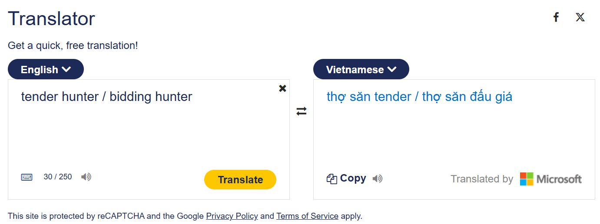

# Tender Hunter Agent - List of References

## Cambridge definition

1. [Definition of Tender in Cambridge](https://dictionary.cambridge.org/vi/dictionary/english/tender)
2. [Definition of Hunter in Cambridge](https://dictionary.cambridge.org/vi/dictionary/english/hunter)
3. [Definition of Bidding in Cambridge](https://dictionary.cambridge.org/dictionary/english/bidding)
4. [Definition of Agent in Cambridge](https://dictionary.cambridge.org/dictionary/english/agent)
5. [Definition of AI Agent in Cambridge](https://www.jbs.cam.ac.uk/executive-education/innovation/agentic-ai/)

## Tender Description and Rules in Viet Nam

1. [The meaning of Tender by luat Minh Khue](https://luatminhkhue.vn/goi-thau-la-gi-cac-loai-goi-thau-theo-quy-dinh-luat-dau-thau.aspx)
2. [The meaning of Tender by Misa](https://amis.misa.vn/161523/dau-thau-la-gi/)
3. [The Tender law in Viet Nam since 2013](https://thuvienphapluat.vn/van-ban/Dau-tu/Luat-dau-thau-2013-215838.aspx)
4. [The Tender law in Viet Nam since 2023](https://xaydungchinhsach.chinhphu.vn/toan-van-luat-dau-thau-119230728060101267.htm?utm_source=chatgpt.com)

## Tender Description and Rules in Global
1. [Mercell](https://info.mercell.com/en/procurement-insights/what-is-public-tendering/) 
2. [AutoRFP](https://autorfp.ai/blog/tender-meaning)

## AI Agent Description in Technical
1. [AI Agent cho mua hàng: tự động hóa nhưng không mất kiểm soát](https://funix.edu.vn/chia-se-kien-thuc/ai-agent-cho-mua-hang/)
2. [Tự động hóa quy trình duyệt chi, mua sắm bằng AI Agent: Từ yêu cầu đến phê duyệt trong một luồng công việc](https://chatask.ai/blog/ai-agent-tu-dong-hoa-quy-trinh-mua-sam)
3. [AI Agent là gì? Ứng dụng AI Agent trong quản trị doanh nghiệp](https://www.citek.vn/ai-agent-la-gi-ung-dung-ai-agent-trong-quan-tri-doanh-nghiep)
4. [AI Agent là gì? Lợi ích và ứng dụng thực tế của AI Agent](https://fpt.ai/vi/bai-viet/ai-agent/)

## The MSC Platform
1. [MSC-Platform](https://muasamcong.mof.gov.vn/web/guest/home)
2. [MSC-Introduction](https://dauthau.asia/news/dau-thau/mua-sam-cong-la-gi-2049.html)
